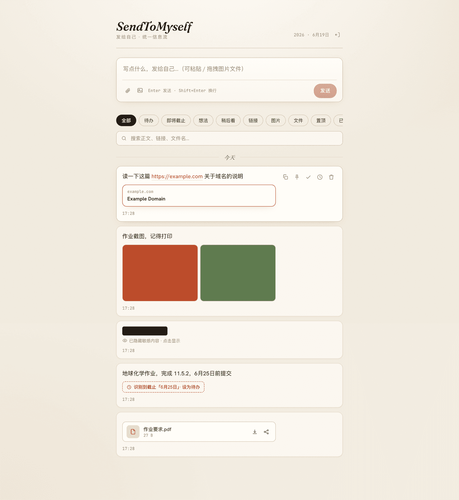
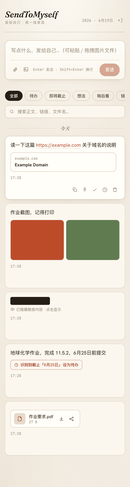
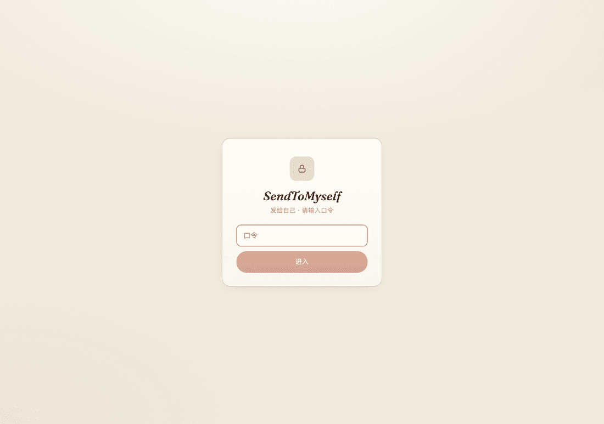

<h1 align="center">SendToMyself · 发给自己</h1>

自托管的跨设备信息流：随手发送文字、链接、图片、文件和待办。

  
  
  
  

 历史版本界面

手机与登录页历史版本界面

 

## 随手发，随时取

手机上的截图、电脑上的链接，或者临时想到的一件事，都可以先发给自己。换一台设备打开，就能继续查看、复制或下载。

- **收在一起**：文字、链接、图片和文件汇集在同一条信息流中。
- **以后找得到**：搜索内容，收藏重要信息，或标记待办并设置截止日期。
- **放在自己的设备上**：将服务部署在 NAS，使用浏览器或客户端连接。

## 下载

| 设备 | 正式版 | 最新候选版 |
| --- | --- | --- |
| NAS 核心与 Web | [1.1.0](https://github.com/Starfie1d1272/send-to-myself/releases/tag/v1.1.0) · [GHCR 镜像](https://github.com/Starfie1d1272/send-to-myself/pkgs/container/send-to-myself) | [1.1.0 RC4](https://github.com/Starfie1d1272/send-to-myself/releases/tag/v1.1.0-rc.4)，含 NAS 运维包 |
| Windows / macOS | [桌面 1.1.0](https://github.com/Starfie1d1272/send-to-myself/releases/tag/desktop-v1.1.0) | [桌面 1.1.0 RC4](https://github.com/Starfie1d1272/send-to-myself/releases/tag/desktop-v1.1.0-rc.4)，配套核心 RC4 |
| HarmonyOS | — | [1.2.0 RC2](https://github.com/Starfie1d1272/send-to-myself/releases/tag/harmony-v1.2.0-rc.2)，配套核心 RC4 |

桌面安装包支持 Windows x64 和 Apple Silicon Mac；Android、iPhone 和 Intel Mac 可使用浏览器。候选版供试用，鸿蒙 HAP 未签名，需自行签名后安装；后台传输和完整设备旅程仍待验收。各版本的详细说明见发布页与[交付表](docs/RELEASES.md)。

## 开始使用

1. 在支持 Docker Compose 的 NAS 上创建数据目录，使用 [Compose 模板](deploy/docker-compose.yml)，填写强口令和数据目录的真实绝对路径，然后在 NAS 界面点击部署。首次部署时，Docker 会拉取所需镜像并启动服务。模板使用核心正式版镜像 `latest`；需要固定版本时可改为对应正式版 tag。候选版本请使用对应发布页的 NAS 运维包，并按发布说明搭配客户端。
2. 在浏览器打开 `http://NAS_IP:8787` 并登录；如果修改了宿主端口，请使用修改后的端口。
3. 在其他设备打开同一可达地址，或在客户端填写该地址并登录。发一条文字或一个文件，再换台设备打开看看。

局域网 HTTP 不加密；远程访问需要 HTTPS 和实际可达的网络路径。`latest` 不会自动更新运行中的容器。升级前先备份，再在 NAS 原项目界面拉取镜像并重建 app 容器。安装、远程访问和备份步骤见[部署指南](docs/DEPLOY.md)。

## 更多文档

- [桌面客户端](apps/desktop/README.md) · [鸿蒙客户端](docs/HARMONY_SHELL.md) · [Raycast 扩展](apps/raycast/README.md)（本地导入，未上架商店）
- [部署、备份与恢复](docs/DEPLOY.md) · [版本管理](docs/VERSIONING.md) · [交付表](docs/RELEASES.md)
- [架构与所有权](docs/ARCHITECTURE.md) · [产品范围](docs/SPEC.md) · [可靠性验证范围](docs/RELIABILITY.md)

源码采用 pnpm monorepo。使用 `.node-version` 和根目录 `packageManager` 指定的版本，运行 `pnpm install` 和 `pnpm dev` 即可启动开发环境；开发态未设置 `AUTH_PASSWORD` 时认证关闭。根目录 Compose 用于源码开发，NAS 安装请使用上面的模板。

许可证：[MIT](LICENSE)。
